# Giải thích dễ hiểu: bài toán gốc, bài toán của nhóm, và cách nhóm giải

Tài liệu này đi từ câu chuyện đời thường đến công thức. Mỗi khái niệm đều có ví dụ bằng số.
Số "Figure X / Table X" là số hình và bảng trong file
`docs/report/Group 5 - Joint UAV trajectory–relay–bandwidth allocation.pdf`; nên mở PDF song song khi đọc.

> Quy ước: ví dụ nào ghi **(minh họa)** là ví dụ tự đặt cho dễ hiểu, không phải kết quả thí nghiệm.
> Số liệu thật lấy từ báo cáo được ghi rõ nguồn (Table/Figure).
>
> Hình nằm trong `docs/explanation-figures/`. Ảnh `report-fig*.png` là hình gốc của báo cáo, xuất riêng ra;
> ảnh `ex*.png` là hình minh họa mới. Mỗi ảnh có file `.tex` (TikZ) cùng tên để sửa; biên dịch lại bằng
> `.claude/skills/latex-document-skill/scripts/compile_latex.sh <file>.tex --preview --scale 1800`.

---

## 0. Tóm tắt trong 5 câu

1. Sau thảm họa, người dân và đội cứu hộ gửi **alert** (tin báo khẩn) về **trung tâm cứu hộ**, nhưng mạng mặt đất đã hỏng một phần.
2. Ta có **1 UAV** làm trạm chuyển tiếp bay trên trời, và một **mạng relay mặt đất** còn sống nhưng dây nối (backhaul) bị giới hạn dung lượng.
3. Ta phải quyết định 3 thứ: **UAV bay đường nào**, **mỗi alert đi đường nào**, **chia băng thông ra sao**.
4. Mục tiêu: **nhiều alert đến kịp hạn (deadline) nhất có thể**. Alert đến trễ thì coi như vô ích.
5. Bài toán rất khó (NP-hard), nên nhóm dùng **tìm kiếm cục bộ** (sửa từng chút một kế hoạch, thử bằng mô phỏng, giữ lại nếu tốt hơn) thay vì giải tối ưu lồi như bài gốc.

---

## 1. Bức tranh tổng thể

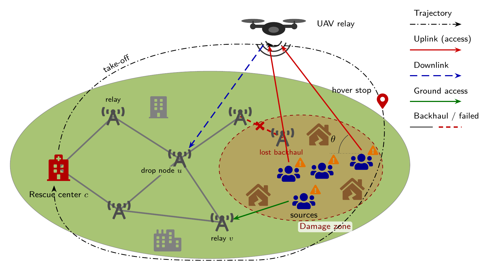

*Hình 1 (Figure 1 của báo cáo). Cách đọc:*
- *Mũi tên đỏ: nguồn gửi lên UAV (uplink/access).*
- *Mũi tên xanh dương nét đứt: UAV thả dữ liệu xuống drop node `u` (downlink).*
- *Mũi tên xanh lá: nguồn gửi thẳng tới relay mặt đất `v`.*
- *Đường xám: dây backhaul; nét đỏ đứt có dấu ✗ là dây bị đứt.*
- *Đường chấm gạch: quỹ đạo của UAV.*

Các thành phần:

| Thành phần | Là gì | Ví dụ đời thường |
|---|---|---|
| **Source** `s` | Nơi phát alert (người dân, đội cứu hộ, cảm biến) | Một nhóm người kẹt trong nhà sập, cầm điện thoại |
| **Alert** `a` | Một gói tin báo: có **kích thước** `L_a` (bit), **thời điểm phát** `r_a`, **hạn chót** `d_a` | "Có 5 người kẹt ở tòa nhà X", 250 kbit, phát ở giây 10, phải tới trước giây 40 |
| **Relay mặt đất** `v` | Trạm phát sóng/router còn sống | Cột sóng BTS chưa sập |
| **Backhaul** `e` | Dây nối giữa các relay, dung lượng `C_e` (bit/giây). Dây đứt thì `C_e = 0` | Cáp quang giữa 2 trạm |
| **UAV** | Drone làm trạm chuyển tiếp, bay được | Drone mang thiết bị phát sóng |
| **Center** `c` | Trung tâm cứu hộ, đích đến của mọi alert | Sở chỉ huy |

**Một alert đi theo 1 trong 2 kiểu đường:**

```
Kiểu 1 – Ground path:  s ──(sóng mặt đất)──► v ──(backhaul)──► ... ──► c
Kiểu 2 – UAV path:     s ──(access)──► UAV ──(downlink)──► u ──(backhaul)──► ... ──► c
                                                         (u = "drop node", nơi UAV thả dữ liệu xuống)
```

Nguồn nào không có relay mặt đất nào trong tầm sóng thì **chỉ có thể** đi kiểu 2, tức là phải nhờ UAV.

---

## 2. Bài toán gốc (Huang et al., 2025) là gì?

Đề số 5 của học phần chỉ định bài tham khảo:
*Huang et al., "Dynamic Dual-Antenna Time-Slot Allocation Protocol for UAV-Aided Relaying System Under Probabilistic LoS-Channel", Sensors 2025.*

### 2.1. Bối cảnh của bài gốc

```
   Người A1 ◄────►  ✈ UAV  ◄────► Người B1        (cặp 1 muốn nói chuyện 2 chiều)
   Người A2 ◄────►   relay  ◄────► Người B2        (cặp 2)
                    (có buffer)
```

- Có **nhiều cặp người dùng** muốn trao đổi tin **hai chiều** với nhau, và UAV đứng giữa chuyển tiếp.
- UAV có **2 ăng-ten** và chia mỗi time slot cho các link khác nhau (đây là giao thức **DDATSAP**).
- **Không có mạng mặt đất**: dữ liệu chỉ đi người → UAV → người.
- Kênh truyền là **PrLoS** (mục 4 bên dưới).

### 2.2. Bài gốc tối ưu cái gì?

- **Biến quyết định:** hệ số chia thời gian (RSF), công suất phát, quỹ đạo UAV.
- **Mục tiêu:** **max–min average rate**, nghĩa là làm sao cho **người có tốc độ trung bình thấp nhất** cũng được tốc độ cao nhất có thể (đảm bảo công bằng).

### 2.3. Bài gốc giải bằng cách nào?

**BCD + SCA:**

```
Lặp:
  1. Cố định công suất + quỹ đạo  → giải bài lồi tìm cách chia thời gian (RSF)   [CVX]
  2. Cố định RSF + quỹ đạo        → xấp xỉ lồi (SCA), giải tìm công suất          [CVX]
  3. Cố định RSF + công suất      → xấp xỉ lồi (SCA), giải tìm quỹ đạo            [CVX]
Đến khi hội tụ.
```

- **BCD (Block Coordinate Descent)**: chia biến thành 3 khối, mỗi lần chỉ tối ưu 1 khối và giữ 2 khối kia cố định.
- **SCA (Successive Convex Approximation)**: bài toán không lồi thì xấp xỉ nó bằng một bài lồi quanh điểm hiện tại, giải, rồi lặp lại.

---

## 3. Bài toán của nhóm khác bài gốc ở đâu?

### 3.1. Bảng so sánh

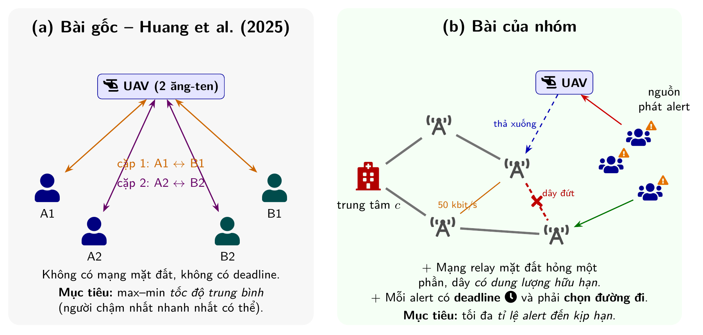

*Hình 2.*
- *Bài gốc (trái): UAV chỉ chuyển tin hai chiều giữa các cặp người dùng; không có mạng mặt đất và không có deadline.*
- *Bài của nhóm (phải): tin đi một chiều về trung tâm. Có thêm mạng relay mặt đất bị hỏng một phần, dây có dung lượng hữu hạn, và mỗi alert có deadline riêng.*

| | **Bài gốc (Huang)** | **Bài của nhóm** |
|---|---|---|
| Ai gửi cho ai | Các cặp người dùng nói chuyện 2 chiều | Nhiều nguồn gửi alert **1 chiều** về **1 trung tâm** |
| Mạng mặt đất | Không có | **Có**, một phần đã hỏng, dây còn sống có **dung lượng hữu hạn** |
| Chọn relay / đường đi | Không (chỉ có UAV) | **Có**: mỗi alert chọn 1 đường (qua UAV hay qua mặt đất, qua relay nào) |
| Hạn chót | Không có | **Mỗi alert có deadline riêng** |
| Mục tiêu | Max–min tốc độ trung bình | **Tỉ lệ alert đến kịp hạn** (timely-delivery ratio) |
| Kênh | PrLoS | PrLoS (giữ nguyên) |
| Cách thiết kế với kênh ngẫu nhiên | Dùng tốc độ **kỳ vọng** | **Mô phỏng trên vài mẫu kênh ngẫu nhiên** |
| Phương pháp | BCD + SCA (tối ưu lồi) | 3 khối như BCD, nhưng **mỗi khối là tìm kiếm cục bộ** chấm điểm bằng mô phỏng |

### 3.2. Vì sao phải đổi mục tiêu? (ví dụ minh họa)

Hai alert, mỗi cái 250 kbit, hạn chót 10 giây:

| Kế hoạch | Alert 1 nhận được | Alert 2 nhận được | Min tốc độ TB | **Số alert đến kịp** |
|---|---|---|---|---|
| P | 125 kbit (50%) | 125 kbit (50%) | 12,5 kbit/s | **0** |
| Q | 250 kbit (100%) | 0 kbit | 0 kbit/s | **1** |

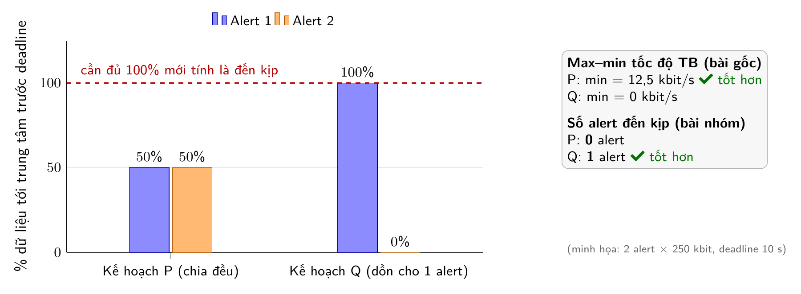

*Hình 3 (minh họa). Hai cách chấm điểm chọn hai kế hoạch ngược nhau:*
- *Max–min chọn P, vì không alert nào bị bỏ đói.*
- *Đếm số alert kịp thì chọn Q, vì ít nhất một tin báo tới đủ.*

- Theo mục tiêu max–min của bài gốc, **P tốt hơn**.
- Nhưng với cứu hộ, **alert nhận một nửa thì vô dụng**, nên **Q tốt hơn**: ít nhất 1 tin báo tới nơi.

Mục tiêu max–min còn có thêm vấn đề: nếu có **1 alert không thể giao được bằng bất kỳ cách nào** (nguồn quá xa), min luôn bằng 0. Khi đó **mọi kế hoạch đều có điểm 0** và mục tiêu không còn phân biệt được kế hoạch nào tốt hơn.

Nhóm có kiểm chứng điều này bằng biến thể **SBS-Lex** (tối ưu theo kiểu công bằng). Biến thể này chỉ đạt 0,369 alert đúng hạn, so với 0,559 của SBS (Table 5).

### 3.3. Vì sao phải thêm mạng mặt đất + backhaul? (ví dụ minh họa)

Giả sử UAV đứng ngay trên đầu nguồn `s`, kênh rất tốt. Nhưng UAV thả dữ liệu xuống relay `u`, mà dây `u → c` chỉ có **50 kbit/s** (kịch bản *Narrow* trong báo cáo):

```
s ──(1000 kbit/s)──► UAV ──(800 kbit/s)──► u ──(50 kbit/s)──► c
                                                   ▲ cổ chai!
```

- Một alert 250 kbit qua dây này mất **5 giây**.
- 3 alert cùng đi qua dây này thì mất **15 giây**. Nếu deadline chỉ 10 giây, sẽ có alert bị trễ.

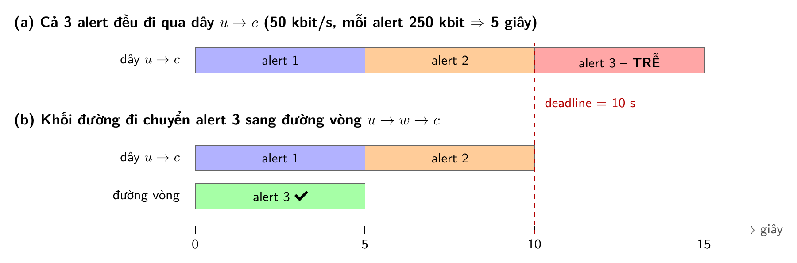

*Hình 4 (minh họa).*
- *(a) Ba alert xếp hàng trên dây 50 kbit/s, nên alert 3 vượt deadline.*
- *(b) Chuyển alert 3 sang đường vòng thì cả ba đều kịp. Đây chính là việc khối đường đi của SBS làm (mục 6.3).*

Các bài trước coi mặt đất là "cái phễu vô hạn", nên **không thấy cổ chai này**. Vì vậy vị trí UAV có kênh tốt nhất **chưa chắc** là vị trí giao được nhiều alert nhất. Phải chọn **cùng lúc** chỗ UAV đứng và relay thả dữ liệu xuống.

---

## 4. Kênh PrLoS: ví dụ bằng số thật

Kênh giữa UAV và mặt đất mỗi giây sẽ **ngẫu nhiên** rơi vào một trong hai trạng thái:

- **LoS (nhìn thẳng)**: sóng đi thẳng, rất mạnh.
- **NLoS (bị che)**: sóng bị nhà cửa chặn, rất yếu.

Xác suất có LoS phụ thuộc **góc ngẩng** từ mặt đất lên UAV. Bảng dưới tính bằng **tham số thật của báo cáo** (Table 3: H = 100 m, a = 9,61, b = 0,16, B = 1 MHz, công suất 0,1 W). Hai cột cuối là số bit truyền được trong nửa giây (access phase):

| Khoảng cách ngang | Góc ngẩng | P(LoS) | Nếu LoS | Nếu NLoS | Trung bình |
|---|---|---|---|---|---|
| 0 m (ngay trên đầu) | 90° | **1,00** | 1158 kbit | 4 kbit | 1158 kbit |
| 100 m | 45° | **0,97** | 757 kbit | ~1 kbit | 733 kbit |
| 300 m | 18° | **0,30** | 198 kbit | ~0 | 59 kbit |
| 500 m | 11° | **0,12** | 76 kbit | ~0 | 9 kbit |

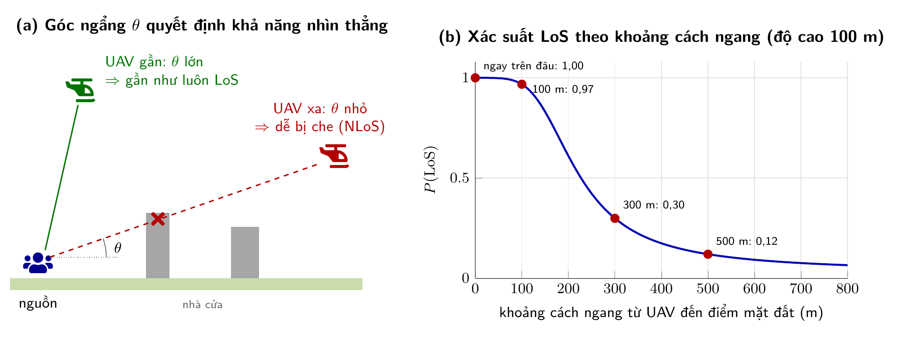

*Hình 5. Hai phần của hình:*
- *(a) UAV ở gần thì góc ngẩng θ lớn, sóng đi từ trên xuống, ít bị nhà cửa che. UAV ở xa thì sóng đi xiên, dễ bị chặn.*
- *(b) Đường cong P(LoS) vẽ bằng tham số thật của báo cáo. Xác suất giảm rất nhanh trong khoảng 100–300 m.*
**Hai bài học:**

1. **UAV càng lại gần thì kênh càng tốt**. Đây là lý do phải tối ưu quỹ đạo.
2. **NLoS gần như bằng 0**, nên kênh kiểu "được ăn cả, ngã về không".

### 4.1. Vì sao "dùng trung bình" đánh lừa ta (ví dụ minh họa)

UAV đứng cách nguồn 300 m. Alert 250 kbit, còn 5 slot trước deadline.

- **Tính theo trung bình:** 59 kbit × 5 slot = 295 kbit ≥ 250. Kết luận: **"chắc chắn kịp"**.
- **Thực tế:** mỗi slot có 30% cơ hội được 198 kbit, còn lại được ~0.
  - Cần **ít nhất 2 slot LoS** trong 5 slot, vì 1 slot chỉ được 198 < 250.
  - P(≥ 2 slot LoS trong 5) = 1 − 0,7⁵ − 5·0,3·0,7⁴ ≈ **0,47**.
  - Tức là **hơn một nửa số lần, alert này bị trễ**.

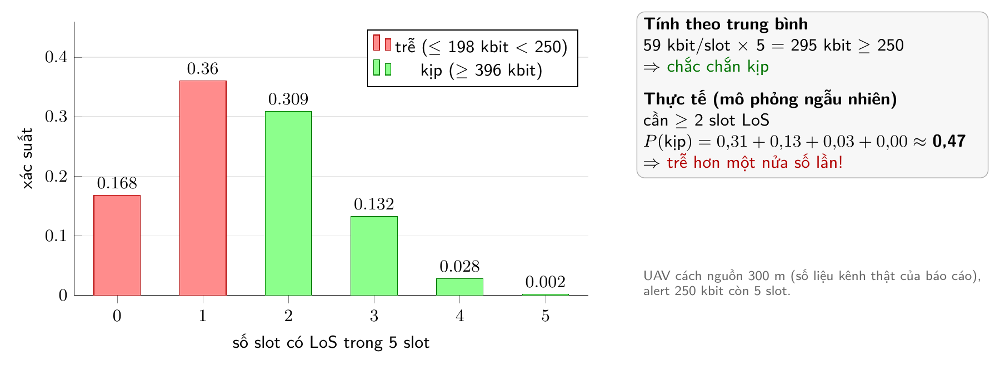

*Hình 6. Phân phối số slot có LoS trong 5 slot:*
- *Cột đỏ: alert trễ, tổng xác suất ≈ 0,53.*
- *Cột xanh: alert kịp, tổng xác suất ≈ 0,47.*
- *Trong khi đó, phép tính theo trung bình kết luận "chắc chắn kịp".*

Báo cáo gọi hiện tượng này là hệ quả của **bất đẳng thức Jensen**: thiết kế theo trung bình đánh giá quá lạc quan. Vì vậy nhóm **không** dùng trung bình, mà **mô phỏng trên 5 mẫu kênh ngẫu nhiên** (mục 6.2).

---

## 5. Phát biểu bài toán của nhóm

### 5.1. Input – Output

**Input (một kịch bản):**

- Đồ thị mạng mặt đất `G = (V, E)` lấy từ Topology Zoo/SNDlib, gồm dung lượng các dây (dây đứt có dung lượng 0).
- 15 nguồn, 40 alert. Mỗi alert có `(nguồn, r_a, d_a, L_a)`.
- Nhiệm vụ dài 150 slot, mỗi slot 1 giây.
- UAV xuất phát tại `q_s`, kết thúc tại `q_t`, tốc độ tối đa 50 m/s.

**Output (một "kế hoạch"):**

1. **Quỹ đạo** `q[0], q[1], ..., q[150]`: vị trí UAV ở mỗi giây. Hai điểm liên tiếp cách nhau ≤ 50 m.
2. **Đường đi** `π_a` cho mỗi alert, hoặc "bỏ qua" alert đó.
3. **Trọng số băng thông** `w` cho mỗi link radio. Trọng số quyết định link nào được chia nhiều băng thông hơn.

### 5.2. Một slot diễn ra thế nào

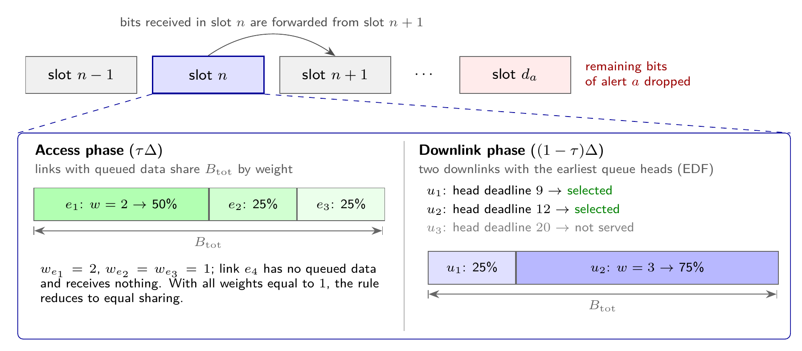

*Hình 7 (Figure 3 của báo cáo). Mỗi slot 1 giây chia đôi:*
- *Access phase (trái): các nguồn gửi lên UAV hoặc relay; 1 MHz được chia theo trọng số `w`.*
- *Downlink phase (phải): UAV gửi xuống tối đa 2 node, ưu tiên hàng đợi có deadline sớm nhất.*
- *Dòng trên cùng: bit nhận ở slot n thì sang slot n+1 mới được chuyển tiếp. Đến slot `d_a` mà chưa tới đủ thì phần còn lại bị bỏ.*

**Ví dụ chia băng thông (minh họa, giống Figure 3):** trong access phase có 3 link đang có dữ liệu chờ, với trọng số `w = 2, 1, 1`. Băng thông chia theo tỉ lệ 2:1:1, tức **50% / 25% / 25%** của 1 MHz. Link không có dữ liệu chờ thì không được chia gì.

**Các luật bắt buộc:**

- **Nhân quả:** bit nhận ở slot n thì sớm nhất slot n+1 mới chuyển tiếp được. Vì vậy một đường 3 chặng mất ít nhất 3 slot.
- **Dung lượng:** mỗi dây backhaul chuyển tối đa `C_e` bit mỗi slot, và các alert đi chung dây phải chia nhau.
- **Deadline:** đến đầu slot `d_a` mà alert chưa tới đủ thì phần còn lại bị **vứt bỏ**.
- **Bộ lập lịch EDF** (Earliest Deadline First): ở mỗi hàng đợi, alert nào hạn sớm hơn thì được gửi trước.

### 5.3. Mục tiêu

```
Tối đa (theo thứ tự ưu tiên):
  1. P_timely  = (số alert đến đủ trước deadline) / (tổng số alert)     ← CHÍNH
  2. Conn      = tỉ lệ nguồn có đường tới trung tâm                      ← phụ (khi hòa ở 1)
  3. − tổng phần dữ liệu còn thiếu                                       ← phụ (khi hòa ở 1, 2)
```

Đây là so sánh **từ điển (lexicographic)**: chỉ khi hai kế hoạch **bằng nhau** ở tiêu chí 1 mới xét tiêu chí 2. Giống như xếp hạng bóng đá: điểm trước, hiệu số sau.

Vì kênh ngẫu nhiên, `P_timely` cũng ngẫu nhiên. Bài toán thật là tối đa **kỳ vọng** của nó, gọi là bài toán **(P1)**.

---

## 6. Nhóm giải bài toán như thế nào?

### 6.1. Bước 1: Chứng minh bài toán khó (NP-hard)

**Ý tưởng chứng minh:** quy về bài **PARTITION** (chia một tập số thành 2 phần có tổng bằng nhau), là bài đã biết NP-hard.

**Ví dụ (minh họa):** có 6 alert, kích thước 3, 1, 1, 2, 2, 1 (tổng 10). Có 2 relay `v1`, `v2`, mỗi dây về trung tâm chỉ chở được **5** đơn vị trong slot cần thiết.

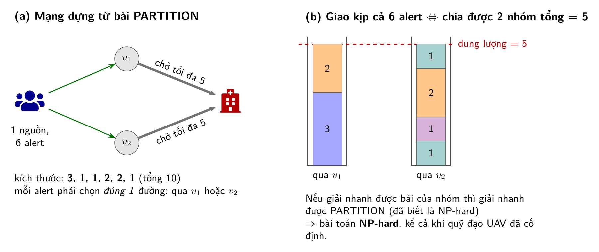

*Hình 8 (minh họa).*
- *(a) Mạng dựng từ bài PARTITION.*
- *(b) Giao kịp cả 6 alert nghĩa là xếp 6 khối vào 2 "thùng", mỗi thùng chứa tối đa 5. Đây chính là bài PARTITION.*

- Giao đủ cả 6 alert đúng hạn ⟺ chia được 6 số thành 2 nhóm tổng bằng 5.
  - Ví dụ: {3, 2} qua v1 và {1, 1, 2, 1} qua v2.
- Nên nếu giải được bài của nhóm nhanh thì cũng giải được PARTITION nhanh.

**Kết luận:** bài toán NP-hard **ngay cả khi quỹ đạo UAV đã cố định**, và chỉ có 2 relay. Cái khó nằm ở chỗ **mỗi alert phải chọn đúng 1 đường** (giống chia đồ vào 2 thùng).

Hệ quả: không hy vọng tìm lời giải tối ưu nhanh, nên dùng **heuristic**.

### 6.2. Bước 2: Dựng cận trên (upper bound) bằng LP

Heuristic cho ra một con số, ví dụ 0,56. Nhưng 0,56 là tốt hay tệ? Cần một **cận trên**: con số mà **không kế hoạch nào vượt qua được**.

- Nhóm viết bài toán dưới dạng **quy hoạch tuyến tính (LP)** gọi là **(P2)**, sau khi **nới lỏng** các ràng buộc:
  - Cho phép chọn "nửa đường" (`x` nằm giữa 0 và 1 thay vì 0 hoặc 1).
  - Thay đường cong tốc độ (log) bằng 10 đường tiếp tuyến nằm phía trên nó.
- Bài toán nới lỏng thì **dễ hơn và rộng hơn**, nên kết quả của nó luôn ≥ mọi kế hoạch thật.
- Cận được giải trên **từng mẫu kênh** và **từng quỹ đạo**.

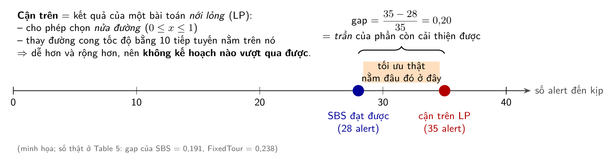

*Hình 9 (minh họa). Tối ưu thật (không biết) nằm giữa kết quả đạt được và cận trên. Gap đo khoảng cách lớn nhất có thể có.*

**Cách đọc:** `gap = (cận − đạt được) / cận`. Gap càng nhỏ thì càng gần tối ưu.
Số thật (Table 5, kịch bản Wide): gap của **SBS = 0,191**, của **FixedTour = 0,238**.

Lưu ý: cận này khá lỏng, vì phần lớn khoảng cách đến từ việc nới lỏng "chọn nửa đường". Nên gap là **trần** của phần có thể cải thiện; phần cải thiện thực tế có thể nhỏ hơn nhiều.

### 6.3. Bước 3: Thuật toán SBS (Sample-scored Block Search) (xem Figure 2)

**Ý tưởng cốt lõi:** thay vì giải bài lồi như Huang, nhóm làm như người thợ chỉnh máy:

> **Sửa một chút → chạy thử → tốt hơn thì giữ, không thì bỏ.**

"Chạy thử" nghĩa là **mô phỏng thật** kế hoạch (với bộ lập lịch EDF thật) trên **5 mẫu kênh ngẫu nhiên**, rồi đếm số alert đến kịp. Mỗi lần chạy thử gọi là 1 **evaluation**, và tổng số evaluation bị giới hạn ở **E = 2000**.

**Vì sao không dùng tối ưu lồi như Huang?** Nhóm đã thử trước (mục "Design Rationale" trong báo cáo):

| Cách làm | Tỉ lệ đến kịp |
|---|---|
| FixedTour (baseline) | 0,410 |
| Lấy lịch băng thông từ lời giải LP rồi chạy thật | **0,128** (tệ hẳn đi!) |
| Tìm kiếm, chấm điểm bằng tốc độ kỳ vọng | 0,427 |
| Tìm kiếm, chấm điểm bằng **5 mẫu ngẫu nhiên** | **0,449** |

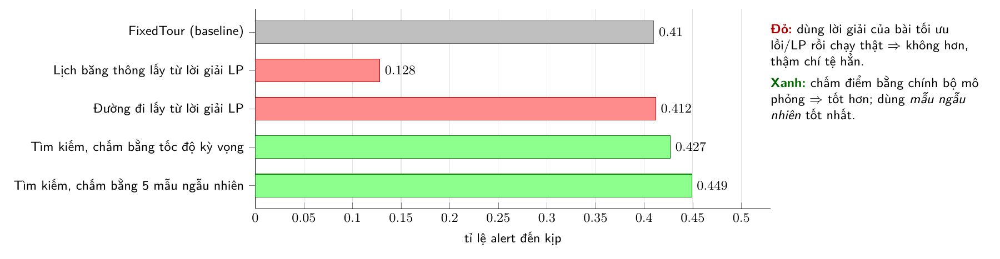

*Hình 10 (số thật, mục Design Rationale của báo cáo).*
- *Lấy lời giải của bài LP rồi đem chạy thật thì không hơn baseline, thậm chí tệ hẳn (0,128).*
- *Chấm điểm bằng chính bộ mô phỏng thì tốt hơn, và tốt nhất khi dùng mẫu ngẫu nhiên.*

Tức là lời giải "đẹp trên giấy" của bài lồi không chạy tốt khi đem ra mô phỏng thật. Vì thế nhóm chuyển sang chấm điểm trực tiếp bằng mô phỏng.

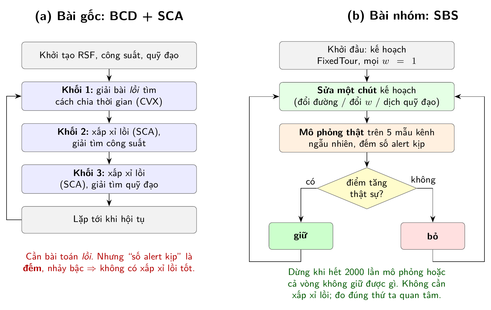

*Hình 11. Điểm giống và khác giữa hai cách giải:*
- *Giống: cả hai đều chia biến thành các khối và lặp lại.*
- *Bài gốc: mỗi khối giải một bài lồi.*
- *SBS: mỗi khối "sửa một chút → mô phỏng → tốt hơn thì giữ".*

**Khung thuật toán** (Figure 2 của báo cáo):

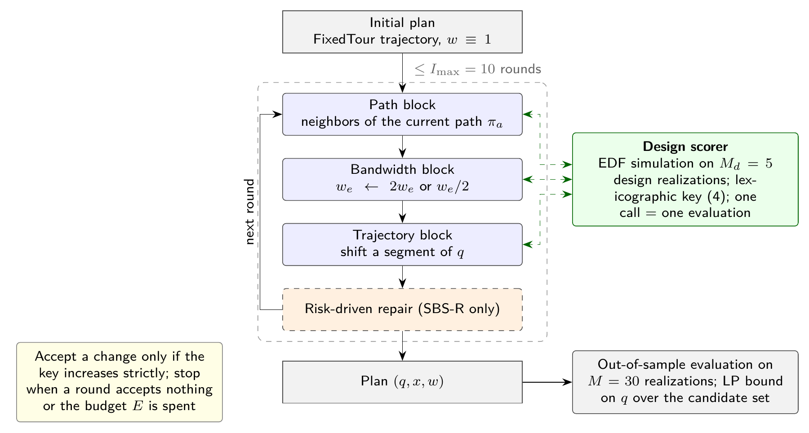

```
Khởi đầu: kế hoạch của FixedTour, mọi trọng số w = 1
Lặp tối đa 10 vòng:
    ① Khối ĐƯỜNG ĐI:   với từng alert, thử đổi đường
    ② Khối BĂNG THÔNG: với từng link, thử nhân đôi / chia đôi trọng số
    ③ Khối QUỸ ĐẠO:    thử dịch một đoạn quỹ đạo UAV
    (④ chỉ SBS-R: sửa các alert sắp trễ)
    Mỗi thay đổi: mô phỏng → điểm TĂNG thật sự thì giữ, không thì bỏ
    Nếu cả vòng không giữ được gì, hoặc hết 2000 evaluation → dừng
```

Phần giống Huang là **3 khối, mỗi lần chỉ sửa 1 khối**. Phần khác là **mỗi khối là tìm kiếm cục bộ chứ không phải bài lồi**.

#### ① Khối đường đi: ví dụ minh họa

Alert `a` đang đi `s → v → u → c`. Lần mô phỏng trước cho thấy dây `u → c` **bị nghẽn** (chạy hết dung lượng).

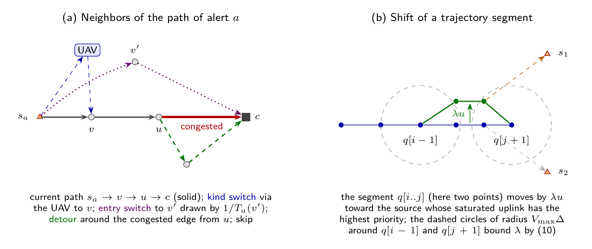

*Hình 12 (Figure 4 của báo cáo).*
- *(a) Các cách sửa đường đi:*
  - *Đường hiện tại: nét liền.*
  - *Đổi kiểu (qua UAV): xanh dương.*
  - *Đổi điểm vào `v'`: tím chấm.*
  - *Đường vòng tránh dây nghẽn: xanh lá.*
- *(b) Cách dịch quỹ đạo, giải thích ở khối ③ bên dưới.*

Các "hàng xóm" được thử lần lượt:

| Kiểu thay đổi | Thử gì |
|---|---|
| **(A) Đổi kiểu** | Đường mặt đất ↔ đường qua UAV (`s → UAV → v → ...`) |
| **(B) Đổi điểm vào** | Vào mạng ở relay khác `v'`, ưu tiên relay gần và dây còn trống |
| **(C) Đường vòng** | Giữ `s → v → u`, nhưng từ `u` đi đường khác tránh dây nghẽn: `u → w → c` |
| **(D) Bỏ qua** | Bỏ alert này để nhường chỗ cho alert khác |

Alert nào **gấp hơn** (cửa sổ `d_a − r_a` ngắn) thì được xét trước, với xác suất cao hơn.

**Ví dụ (minh họa):** dây `u → c` 50 kbit/s đang chở 3 alert × 250 kbit, mất 15 s, deadline 10 s, nên có 1 alert trễ. Chuyển alert đó sang đường vòng `u → w → c` thì cả 3 đều kịp. Điểm tăng nên **giữ** thay đổi này.

Điểm hay: các đường này **có thể nằm ngoài** danh sách 3 đường ứng viên tính trước. Thực tế, trong kế hoạch cuối, một phần đáng kể alert đi đường mà danh sách ban đầu không có.

#### ② Khối băng thông

Với mỗi link radio đang dùng (link chở nhiều dữ liệu nhất xét trước):

- Thử `w ← 2w` (link này được chia nhiều băng thông hơn). Mô phỏng, tốt hơn thì giữ.
- Nếu không tốt hơn thì thử `w ← w/2`.

Băng thông thực tế mỗi slot vẫn **chỉ chia cho các link đang có dữ liệu chờ** (Figure 3). Nhờ vậy nó tự thích nghi với hàng đợi, khác với lịch băng thông cứng cố định trước.

#### ③ Khối quỹ đạo: xem Hình 12 phần (b)

Trong Hình 12(b):
- Các chấm xanh dương là vị trí UAV qua từng giây.
- Đoạn ở giữa (hai điểm) được **dịch cả khối** lên phía `s1`, thành các chấm xanh lá, vì link `s1 → UAV` đang bị bão hòa.
- Hai vòng tròn nét đứt có bán kính 50 m (tốc độ tối đa × 1 giây) quanh hai điểm đứng yên. Các điểm mới phải nằm trong hai vòng này, tức là giới hạn khoảng dịch `λ`.

1. Mô phỏng kế hoạch hiện tại, tìm các **slot mà link UAV ↔ mặt đất bị bão hòa** (chạy hết công suất). Link chở alert to hoặc gấp thì có ưu tiên cao hơn.
2. Lấy đoạn quỹ đạo tương ứng và **dịch cả đoạn** về phía điểm mặt đất đó.
3. Khoảng dịch được tính sao cho **không vi phạm tốc độ 50 m/s**: chỉ 2 bước ở hai đầu đoạn bị kéo giãn, nên tính được bằng công thức đóng.
4. Thử dịch hết cỡ `λ*`, rồi thử một nửa `λ*/2`.
5. Thỉnh thoảng (xác suất 10%) thử hẳn một tour bay khác để thoát khỏi cực trị địa phương.

Theo bảng PrLoS ở mục 4: dịch UAV từ cách 300 m xuống còn 100 m thì P(LoS) tăng từ 0,30 lên 0,97. Đó là lý do một cú dịch nhỏ có thể cứu nhiều alert.

#### ④ Sửa lịch theo rủi ro – SBS-R

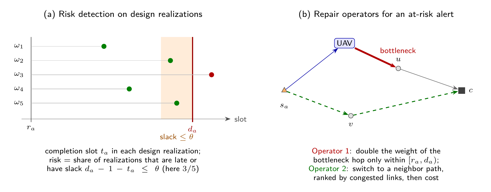

*Hình 13 (Figure 5 của báo cáo).*
- *(a) Mỗi dòng ω₁…ω₅ là một mẫu kênh; chấm là thời điểm alert hoàn tất. Chấm đỏ là trễ; chấm rơi vào vùng cam là suýt trễ. Ở đây 3/5 mẫu có vấn đề, nên rủi ro = 0,6.*
- *(b) Hai thao tác sửa: tăng băng thông cho chặng cổ chai (đỏ), hoặc đổi đường (xanh lá).*

Biến thể **SBS-R** thêm một bước sau mỗi vòng:

1. Trên 5 mẫu kênh, đo xem mỗi alert **trễ hoặc suýt trễ** (còn ≤ 2 slot dư) bao nhiêu lần. Ví dụ 3/5 lần thì rủi ro = 0,6.
2. Lấy 10 alert rủi ro cao nhất. Với mỗi alert:
   - **Operator 1:** nhân đôi băng thông cho chặng cổ chai, **chỉ trong cửa sổ thời gian của alert đó**.
   - **Operator 2:** đổi sang đường ít dây nghẽn hơn.

**Kết quả:** gần như **không cải thiện thêm** so với SBS (+0,002, không có ý nghĩa thống kê). Đây là một phát hiện "âm tính" nhưng trung thực.

---

## 7. Ví dụ đầy đủ từ đầu đến cuối (minh họa)

**Kịch bản nhỏ:**
- `s1` ở gần relay `v1`, mà `v1` nối về trung tâm bằng dây 1000 kbit/s.
- `s2` ở vùng B, không có relay nào trong tầm.
- Relay `v2` nối về trung tâm bằng dây chỉ 50 kbit/s.

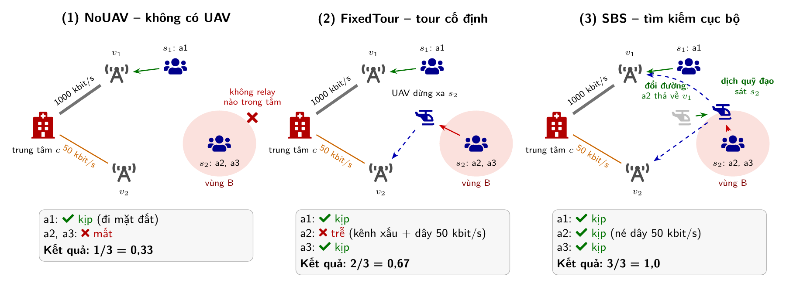

*Hình 14 (minh họa). Cùng một kịch bản, ba cách lập kế hoạch:*
1. *NoUAV: `s2` bị cô lập, nên a2 và a3 mất.*
2. *FixedTour: UAV dừng xa `s2`, nên kênh xấu; thêm dây 50 kbit/s làm a2 trễ.*
3. *SBS: dịch quỹ đạo sát `s2` (mũi tên xanh lá từ vị trí cũ màu xám), và cho a2 thả về `v1` để né dây hẹp. Cả 3 alert đều kịp.*

Ba alert, mỗi cái 250 kbit:

| Alert | Nguồn | Phát (giây) | Deadline (giây) |
|---|---|---|---|
| a1 | s1 | 0 | 20 |
| a2 | s2 | 0 | 30 |
| a3 | s2 | 5 | 40 |

**NoUAV** (không có UAV): a1 đi `s1 → v1 → c`, kịp. s2 không với tới relay nào, nên a2 và a3 **mất**.
Kết quả: **1/3 = 0,33**.

**FixedTour** (UAV bay tour cố định A → B, chia đều thời gian):

- a1 vẫn đi mặt đất, kịp.
- a2, a3: UAV tới vùng B lúc giây ~15, nhận dữ liệu rồi thả xuống `v2`. Nhưng dây `v2 → c` chỉ 50 kbit/s, mỗi alert mất 5 s, mà UAV lại hay ở xa (P(LoS) thấp). Chỉ a3 kịp.
- Kết quả: **2/3 = 0,67**.

**SBS** (tìm kiếm cục bộ):

- Khối quỹ đạo: thấy link `s2 → UAV` bão hòa nên dịch đoạn quỹ đạo về sát s2, kênh gần như luôn LoS.
- Khối đường đi: thử cho a2 thả xuống `v1` thay vì `v2` (UAV bay về gần v1 rồi thả, đi dây 1000 kbit/s), né cổ chai 50 kbit/s.
- Mỗi thay đổi đều được mô phỏng trên 5 mẫu kênh, và chỉ được giữ khi số alert kịp tăng.
- Kết quả: **3/3 = 1,0**.

Ví dụ này cho thấy đúng **3 khó khăn** mà bài nêu ở Introduction:

1. Mục tiêu là **đếm** số alert kịp, nên nhảy bậc và không trơn (khó dùng tối ưu lồi).
2. **Relay gần nhất chưa chắc tốt nhất** vì backhaul (`v2` có dây 50 kbit/s).
3. Kênh **ngẫu nhiên**, nên thiết kế theo trung bình sẽ quá lạc quan.

---

## 8. Kết quả thật (Table 5, 6, 7, 9)

Đánh giá trên 30 kịch bản (10 topology × 3 lần lặp), mỗi kế hoạch chạy trên 30 mẫu kênh mới, khác với 5 mẫu dùng khi thiết kế.

**Tỉ lệ alert đến kịp:**

| Phương pháp | Wide (backhaul 1000 kbit/s) | Narrow (backhaul 50 kbit/s) |
|---|---|---|
| NoUAV | 0,413 | 0,370 |
| FixedTour | 0,494 | 0,430 |
| **SBS** (đề xuất) | **0,559** | **0,517** |
| SBS-R (thêm repair) | 0,560 | 0,521 |
| SBS-Lex (mục tiêu công bằng) | 0,369 | 0,336 |

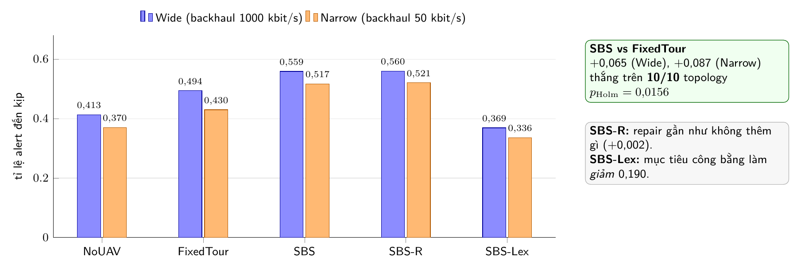

*Hình 15 (số thật, Table 5).*
- *Thứ hạng giữ nguyên ở cả hai kịch bản: SBS ≈ SBS-R > FixedTour > NoUAV > SBS-Lex.*
- *Khi backhaul hẹp (cột cam), mọi phương pháp đều giảm, nhưng khoảng cách giữa SBS và FixedTour lại rộng ra.*

**Đọc kết quả:**

- **SBS thắng FixedTour trên cả 10/10 topology** (p Holm = 0,0156). Khoảng cách **lớn hơn khi backhaul hẹp** (+0,065 ở Wide, +0,087 ở Narrow). Điều này hợp lý: backhaul càng hẹp thì việc chọn đường càng quan trọng.
- **Tran-IA** (phương pháp mạnh nhất từ tài liệu, đã chuyển thể cho bài này): SBS hơn nó +0,028 (Wide) và +0,079 (Narrow), **nhưng chưa đủ ý nghĩa thống kê** sau hiệu chỉnh Holm.
- **Ablation** (bỏ từng phần ra để xem phần nào quan trọng):
  - **Quan trọng:** chọn đường và quỹ đạo **cùng lúc**, và chấm điểm trên **mẫu ngẫu nhiên** thay vì trung bình.
  - **Gần như không đóng góp:** trọng số băng thông riêng, và cơ chế repair.
  - **Có hại:** mục tiêu công bằng (leximin), làm giảm 0,190.
- **Case study RescueNet** (63 mục tiêu lấy từ ảnh thật sau bão): thứ hạng các phương pháp không đổi.

---

## 9. Ôn lại bằng một sơ đồ

```
BÀI GỐC (Huang)                          BÀI CỦA NHÓM
──────────────                           ─────────────
Cặp người ↔ UAV ↔ cặp người              Nguồn → (UAV hoặc mặt đất) → mạng relay → trung tâm
Không có mạng mặt đất                    + Mạng mặt đất hỏng một phần, backhaul hữu hạn
Không deadline                           + Mỗi alert có deadline
Max–min tốc độ trung bình                → Tỉ lệ alert đến kịp
Biến: thời gian, công suất, quỹ đạo      → Biến: quỹ đạo, ĐƯỜNG ĐI, băng thông
Giải: BCD + SCA (bài lồi, CVX)           → Giải: BCD-kiểu, mỗi khối = tìm kiếm cục bộ,
                                            chấm điểm bằng mô phỏng trên 5 mẫu kênh
                                         + Chứng minh NP-hard
                                         + Cận trên LP để biết còn cách tối ưu bao xa
```

## 10. Thuật ngữ nhanh

| Thuật ngữ | Nghĩa ngắn gọn |
|---|---|
| Timely-delivery ratio | Tỉ lệ alert đến **đủ** dữ liệu **trước** deadline |
| Backhaul | Dây nối giữa các relay mặt đất |
| Drop node `u` | Relay mặt đất nơi UAV thả dữ liệu xuống |
| Candidate paths (K = 3) | 3 đường tính sẵn cho mỗi alert, dùng làm điểm xuất phát |
| EDF | Earliest Deadline First: hạn sớm hơn thì gửi trước |
| Realization ω | Một lần "bốc thăm" trạng thái LoS/NLoS cho mọi link ở mọi slot |
| Design / evaluation realizations | 5 mẫu dùng khi thiết kế / 30 mẫu khác dùng khi chấm điểm cuối |
| SAA (Sample Average Approximation) | Xấp xỉ kỳ vọng bằng trung bình trên vài mẫu |
| Evaluation budget E | Số lần mô phỏng tối đa được phép (2000) |
| Lexicographic | So tiêu chí 1 trước, hòa mới xét tiêu chí 2 |
| Holm correction | Hiệu chỉnh p-value khi làm nhiều phép kiểm định cùng lúc |
| Ablation | Bỏ bớt từng thành phần để đo đóng góp của nó |
